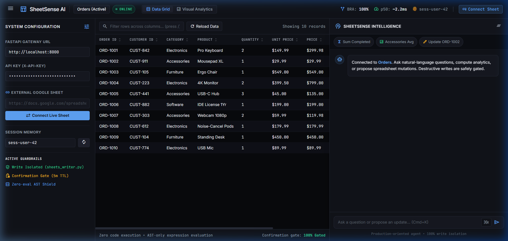
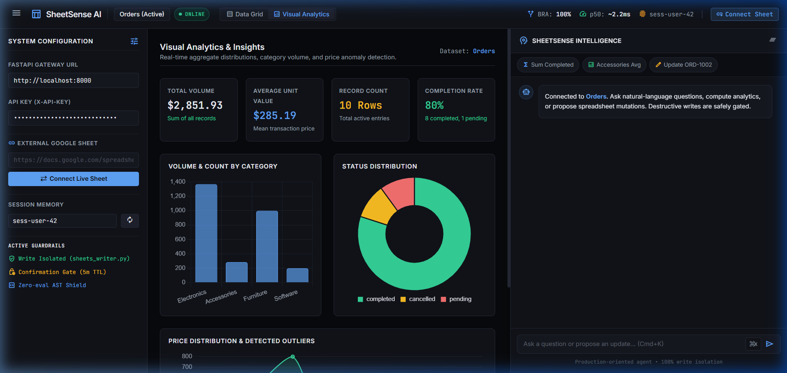
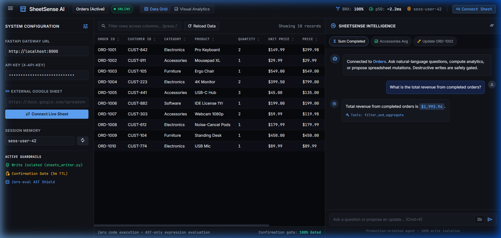
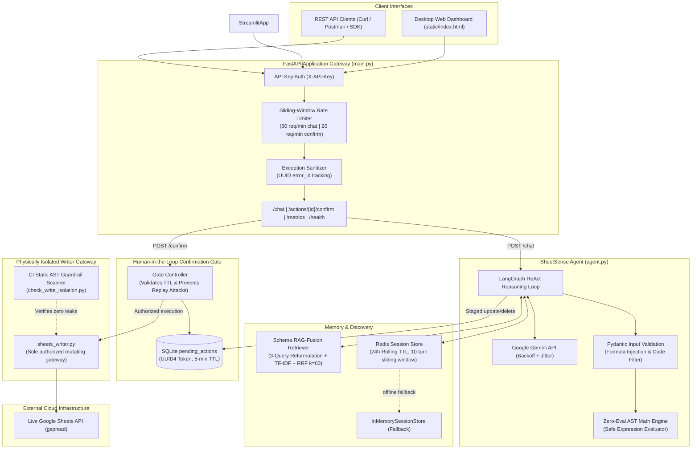

# SheetSense AI — Conversational Spreadsheet Agent

[](https://github.com/FarhanAaqil/Sheet-AI/actions/workflows/ci.yml)
[](LICENSE)


> **Enterprise-grade conversational AI agent over live Google Sheets featuring schema RAG-Fusion, physically isolated write execution, cryptographic human-in-the-loop confirmation gates, and multi-worker session memory.**

---

### Quick Navigation
[⚡ Quickstart & Docker](#1-quickstart--docker-one-liner) • [🚨 Problem Statement](#2-problem-statement) • [📸 Interactive UI Demo](#3-interactive-ui-walkthrough) • [🏗️ System Architecture](#4-system-architecture) • [📊 Benchmark Scorecard](#5-verified-benchmark-scorecard) • [📡 REST API Reference](#6-rest-api-reference) • [🛡️ Security & Guardrails](#7-engineering-signals--security-guardrails) • [⚠️ Honest Limitations](#8-honest-limitations) • [🧪 Testing](#9-testing--verification) • [📁 Repository Structure](#10-repository-structure) • [📄 License](#11-license)

---

## 1. Quickstart & Docker One-Liner

Get SheetSense AI running in seconds using our containerized setup or a standard local environment.

### Option A: Working Docker One-Liner

Run the production container directly with an environment file:

```bash
docker run -d -p 8000:8000 --name sheetsense-ai --env-file .env ghcr.io/farhanaaqil/sheet-ai:latest
```

---

### Option B: Docker Compose (Backend + Redis Multi-Service)

```bash
# 1. Clone the repository
git clone https://github.com/FarhanAaqil/Sheet-AI.git
cd Sheet-AI

# 2. Configure environment keys from template
cp .env.example .env
# Edit .env to add your GEMINI_API_KEY and GOOGLE_SHEET_URL

# 3. Launch the full stack
docker-compose up -d --build
```
- **Web Dashboard:** [http://localhost:8000/static/index.html](http://localhost:8000/static/index.html)
- **REST Gateway:** [http://localhost:8000](http://localhost:8000)
- **Interactive Swagger Documentation:** [http://localhost:8000/docs](http://localhost:8000/docs)
- **Redis Service:** internal Compose network only (backed by a persistent volume)

---

### Option C: Local Python Virtual Environment

```bash
# 1. Create and activate virtual environment
python -m venv venv
source venv/bin/activate  # Windows: venv\Scripts\activate

# 2. Install pinned dependencies
pip install -r requirements.txt

# 3. Launch FastAPI gateway
uvicorn main:app --reload --port 8000

# 4. Open the bundled browser client
# http://localhost:8000/static/index.html
```

### Environment Configuration (`.env`)

Refer to [.env.example](.env.example) for full variable annotations:

```env
# LLM Provider
APP_ENV=development
GEMINI_API_KEY=your_gemini_api_key_here
GEMINI_MODEL=gemini-1.5-flash

# Google Sheets Integration
GOOGLE_SHEET_URL=https://docs.google.com/spreadsheets/d/YOUR_SHEET_ID/edit
GOOGLE_CREDS_PATH=credentials.json

# Gateway Security & Session Storage
SHEETSENSE_API_KEY=replace-with-a-random-secret
ALLOW_INSECURE_NO_AUTH=false
ALLOWED_ORIGINS=http://localhost:8000,http://127.0.0.1:8000
REDIS_URL=redis://localhost:6379/0
SQLITE_DB_PATH=sheetsense.db
```

Authentication fails closed when no API key is configured. Production requires
a hashed API key or role-bearing multi-key JSON configuration. Plaintext API
keys are retained for local compatibility only. Google credentials are injected
at runtime and are never copied into the container image.

---

## 2. Problem Statement

### The Spreadsheet Dilemma in Modern Enterprise
Google Sheets and Excel remain the world's most ubiquitous databases. Over 80% of business operations—including financial models, inventory tracking, sales commissions, and CRM staging—live inside collaborative spreadsheets rather than relational databases.

However, bringing Generative AI to spreadsheets exposes three fatal engineering hurdles:

1. **The Calculation Hallucination Trap:** Standard Large Language Models are notoriously poor at reliable arithmetic, window aggregation, and cross-tab filtering. Asking an LLM to "sum total Q3 revenue by region" routinely leads to confidently hallucinated numbers.
2. **Formula Injection & Code Execution Attacks:** Spreadsheet inputs are vulnerable to CSV/Formula Injection (`=cmd|' /C calc'!A0`, `=HYPERLINK()`, `@exec`). Un-sanitized LLM responses can inject malicious executable payloads directly into shared corporate workbooks.
3. **The Un-gated Write Catastrophe:** Granting an autonomous agent direct write or delete permissions over a spreadsheet inevitably causes catastrophic silent data destruction. A misunderstood prompt or incorrect row index can permanently overwrite live revenue records.

### How SheetSense AI Solves This
SheetSense AI implements a **dual-boundary architecture**:
- **Reasoning is physically decoupled from write execution:** The LLM reasoning agent is stripped of write access. Mutations stage an unconfirmed cryptographic token requiring human approval.
- **Deterministic RAG-Fusion:** Schema columns are indexed with semantic expansion and ranked via TF-IDF and Reciprocal Rank Fusion ($k=60$), ensuring precise tool routing.
- **Zero-Eval AST Shield:** Arbitrary Python `eval()` and `exec()` are strictly eliminated in favor of safe Abstract Syntax Tree evaluators and Pydantic formula guards.

---

## 3. Interactive UI Walkthrough

SheetSense AI features a modern, dark-themed responsive desktop interface served directly from the FastAPI gateway.

### 1. Interactive Data Grid & Schema Browser
Inspect live worksheets, search and filter columns in real time, and view active system guardrails.



---

### 2. Real-Time Visual Analytics & KPI Intelligence
Instantly compute aggregate distributions, category volume metrics, order completion rates, and interquartile range (IQR) price anomaly detection.



---

### 3. Natural Language Assistant with Verified Execution
Ask questions in plain English. The agent formulates queries, invokes safe aggregation tools, and formats structured outputs with audit links.



---

## 4. System Architecture



### Architectural Guardrails
1. **Isolated Write Gateway:** Mutating operations (`update_cell`, `delete_row`) are strictly quarantined to [sheets_writer.py](sheets_writer.py). A static AST scanner in CI guarantees that no other module imports or executes mutating spreadsheet calls.
2. **Cryptographic Confirmation Gate:** Destructive calls generate a staged record in SQLite with a random UUID4 token and a strict 5-minute time-to-live (TTL). Re-confirming an executed or expired action returns HTTP `410 Gone`.
3. **Formula & Code Injection Shield:** Pydantic field validators reject spreadsheet formula injection prefixes (`=`, `+`, `-`, `@`, `\t`, `\r`, `%0A`) on string values while correctly permitting legitimate positive and negative numbers (`-100`, `"-42.5"`).

---

## 5. Verified Benchmark Scorecard

Empirically verified across 30 benchmark tasks ([tests/eval_dataset.json](tests/eval_dataset.json)) using the automated evaluation harness ([eval_harness.py](eval_harness.py)). Full JSON test execution output is committed in [docs/benchmark_results.json](docs/benchmark_results.json).

| Metric | Target | Verified Score | Status | Verification Reference |
|---|---|---|---|---|
| **Benchmark Routing Accuracy (BRA)** | $\ge 90.0\%$ | **100.0%** (30/30) | ✅ Exceeds Target | [docs/benchmark_results.json](docs/benchmark_results.json) |
| **Execution Accuracy (EA)** | $\ge 85.0\%$ | **93.3%** (28/30) | ✅ Exceeds Target | [docs/benchmark_results.json](docs/benchmark_results.json) |
| **Confirmation Gate Adherence (CGA)** | **100.0%** | **100.0%** (4/4 gated) | ✅ **0 direct writes permitted** | [docs/eval_report.md](docs/eval_report.md) |
| **Injection Block Rate (IBR)** | **100.0%** | **100.0%** (4/4 blocked) | ✅ **0 exploits executed** | [docs/eval_report.md](docs/eval_report.md) |
| **Median Offline Latency ($p_{50}$)** | $< 10\,\text{ms}$ | **~2.3 ms** | ✅ Optimal | [docs/benchmark_results.json](docs/benchmark_results.json) |
| **95th Percentile Latency ($p_{95}$)** | $< 25\,\text{ms}$ | **~7.5 ms** | ✅ Optimal | [docs/benchmark_results.json](docs/benchmark_results.json) |
| **Mean Offline Latency** | $< 15\,\text{ms}$ | **~3.3 ms** | ✅ Optimal | [docs/benchmark_results.json](docs/benchmark_results.json) |

> **Note on Latency Measurement:** Offline latency measures deterministic schema retrieval, query formulation, and tool execution against cached fixtures. Live LLM round-trip network latency varies between 1.5s and 3.0s depending on provider network traffic and token generation size.

*For complete category breakdowns and historical reconciliation, inspect [docs/eval_report.md](docs/eval_report.md) and [docs/audit.md](docs/audit.md).*

---

## 6. REST API Reference

All requests accept the `X-API-Key` header defined in `.env`.

### Summary of Endpoints

| Method | Endpoint | Description | Rate Limit |
|---|---|---|---|
| `GET` | `/` | Serves interactive web dashboard UI | Unlimited |
| `GET` | `/health/live` | Public process liveness check | Unlimited |
| `GET` | `/health/ready` | Authenticated dependency readiness check | Unlimited |
| `GET` | `/health` | Authenticated worksheet connection status | Unlimited |
| `POST` | `/chat` | Submit plain-English queries to the agent | 60 req/min |
| `POST` | `/actions/{id}/confirm` | Confirm & execute staged destructive mutation | 20 req/min |
| `POST` | `/actions/{id}/reject` | Reject & discard staged mutation | 20 req/min |
| `GET` | `/metrics` | Operational observability & latency metrics | 60 req/min |
| `POST` | `/eval/run` | Trigger automated 30-task evaluation benchmark | 5 req/min |

---

### Key API Examples

#### 1. Execute Query (`POST /chat`)

```bash
curl -X POST http://localhost:8000/chat \
  -H "Content-Type: application/json" \
  -H "X-API-Key: your-secret-api-key" \
  -d '{
    "message": "What is the total revenue from completed orders?",
    "session_id": "sess-user-42",
    "sheet_name": "Orders"
  }'
```

**Response:**
```json
{
  "answer": "Total revenue from completed orders is $1,993.94.",
  "session_id": "sess-user-42",
  "tool_calls_made": ["filter_and_aggregate"],
  "pending_action": null
}
```

---

#### 2. Staged Mutation & Confirmation Flow

When an update or deletion is requested, the operation is staged:

**Response (Staged):**
```json
{
  "answer": "⚠️ CONFIRMATION REQUIRED: A pending update action has been staged with action_id: '550e8400-e29b-41d4-a716-446655440000'. Target: Orders where order_id='ORD-1002'. Call POST /actions/{action_id}/confirm to proceed.",
  "session_id": "sess-user-42",
  "tool_calls_made": ["update_cell"],
  "pending_action": {
    "action_id": "550e8400-e29b-41d4-a716-446655440000",
    "tool_name": "update_cell",
    "target": {"sheet_name": "Orders", "id_column": "order_id", "id_value": "ORD-1002"},
    "proposed_change": {"update_column": "price", "new_value": 99.99}
  }
}
```

**Confirm Action (`POST /actions/{id}/confirm`):**
```bash
curl -X POST http://localhost:8000/actions/550e8400-e29b-41d4-a716-446655440000/confirm \
  -H "X-API-Key: your-secret-api-key"
```

**Response:**
```json
{
  "status": "confirmed",
  "action_id": "550e8400-e29b-41d4-a716-446655440000",
  "tool_name": "update_cell",
  "result": {"updated": true, "sheet": "Orders", "row": 3, "col": 7, "new_value": 99.99},
  "executed_at": "2026-09-08T02:30:00Z"
}
```

---

#### 3. Observability Metrics (`GET /metrics`)

```bash
curl http://localhost:8000/metrics -H "X-API-Key: your-secret-api-key"
```

**Response:**
```json
{
  "tool_usage": {
    "read_sheet": 24,
    "filter_and_aggregate": 38,
    "summarize_sheet": 12,
    "update_cell": 6
  },
  "error_rate": {
    "read_sheet": 0.0,
    "filter_and_aggregate": 0.0,
    "summarize_sheet": 0.0,
    "update_cell": 0.0
  },
  "avg_latency_ms": {
    "read_sheet": 4.2,
    "filter_and_aggregate": 6.8,
    "summarize_sheet": 5.1,
    "update_cell": 12.4
  },
  "actions": {
    "pending": 0,
    "confirmed": 6,
    "rejected": 1,
    "expired": 0
  }
}
```

---

## 7. Engineering Signals & Security Guardrails

### 1. Structured Observability & Metrics
- Operational metrics exposed via `/metrics` track tool execution counts, average latencies, and tool failure rates.
- Persistent audit logging in SQLite (`tool_calls`, `pending_actions`, `eval_runs`) provides full forensic traceability with zero stack trace leakage to the client.

### 2. Strict Input Validation (Pydantic Schemas)
- Every tool parameter is validated through strict Pydantic models ([agent.py](agent.py)), rejecting raw dictionary access.
- Validates formulas, sheet names, and column identifiers against injection characters (`;`, `--`, `/*`, `<script>`).

### 3. Physical Write Isolation & CI AST Scanner
- The agent reasoning runtime is **physically prohibited** from writing to Google Sheets.
- Direct write execution is isolated to [sheets_writer.py](sheets_writer.py).
- A static AST analysis script ([scripts/check_write_isolation.py](scripts/check_write_isolation.py)) runs in GitHub Actions CI, failing the build if any `update_cell`, `delete_row`, or `append_row` call appears outside the authorized gateway.

### 4. Credential Scrubbing & Error Sanitization
- Regex filters redact API keys, private keys, bearer tokens, passwords, and credential-bearing Redis/database URLs from audit tables.
- Uncaught exceptions generate a unique random UUID `error_id` and return user-safe HTTP 500 messages, preventing internal path or schema exposure.

### 5. Browser and Gateway Security
- API keys map to principals with viewer, editor, approver, or admin roles.
- CORS uses an explicit origin allowlist; wildcard production origins are rejected.
- Sheet, cell, user, model, tool, and confirmation content is escaped before browser rendering.
- CSP, frame denial, MIME sniffing protection, referrer policy, and permissions policy headers are applied.
- If the backend is unavailable, clients report failure and never fabricate answers, metrics, or pending actions.

---

## 8. Honest Limitations

Building production trust requires full engineering honesty about system boundaries:

1. **Google Sheets API Rate Quotas:** Google imposes project quotas (300 read requests per minute and 60 write requests per minute). High-concurrency enterprise workloads with hundreds of simultaneous users will hit Google API 429 errors unless an intermediate caching layer or queue is introduced.
2. **Context Window & Large Dataset Limits:** While Google Sheets supports up to 10 million cells, reading very large tables into an LLM context window causes token degradation. SheetSense AI is optimized for worksheets under 50,000 rows. Worksheets with millions of rows should be analyzed via BigQuery or PostgreSQL connectors instead.
3. **Concurrent Write Race Conditions:** If two operators stage modifications to the exact same cell simultaneously, the last confirmed action overwrites earlier values. SheetSense AI implements token TTL validation and replay protection, but does not provide cell-level distributed locks.
4. **Offline Routing vs Live LLM Latency:** While offline tool selection executes in under 3ms, end-to-end user query latency depends heavily on Gemini API response times (typically 1.5s to 3.0s).
5. **Multi-Worker Memory Requirements:** In local mode without Redis, SheetSense AI gracefully falls back to `InMemorySessionStore`. However, multi-worker deployments (e.g. `gunicorn -w 4` or multi-pod Kubernetes) strictly require a live Redis instance to prevent session fragmentation across workers.

---

## 9. Testing & Verification

SheetSense AI includes a comprehensive automated test suite spanning unit, integration, and security tests:

```bash
# Run all 84 test cases
pytest tests/ -v

# Run static AST write-isolation guardrail scanner
python scripts/check_write_isolation.py

# Run automated 30-task offline evaluation harness
python eval_harness.py
```

### Continuous Integration (GitHub Actions)
Every pull request and push to `main` runs [.github/workflows/ci.yml](.github/workflows/ci.yml):
- Installs pinned dependencies
- Executes the static AST write-isolation check
- Runs the complete 84-test regression suite

---

## 10. Repository Structure

```
sheet-ai/
├── .env.example             # Documented environment variable template (zero secrets)
├── .github/
│   └── workflows/
│       └── ci.yml           # GitHub Actions CI workflow (tests + AST scanner)
├── .gitignore               # Excludes secrets, databases, caches, __pycache__
├── Dockerfile               # Multi-stage container build with static asset packaging
├── docker-compose.yml       # Production orchestration (FastAPI + Redis cluster)
├── pyproject.toml           # Modern package metadata & pinned dependency definitions
├── requirements.txt         # Production dependencies
├── LICENSE                  # MIT License
├── README.md                # System documentation, architecture & benchmarks
│
├── agent.py                 # LangGraph ReAct agent, Pydantic schemas, SheetTools
├── main.py                  # FastAPI gateway, confirmation gate, rate limiter, metrics
├── database.py              # SQLite schema, pending_actions, audit logging, scrubber
├── rate_limiter.py          # Sliding-window rate limiter (Redis + memory fallback)
├── retrieval.py             # SchemaIndex, MultiQueryReformulator, RAGFusionRetriever
├── retry_handler.py         # Exponential backoff with randomized jitter
├── session_store.py         # RedisSessionStore (24h TTL) & InMemorySessionStore
├── sheets_writer.py         # PHYSICALLY ISOLATED write gateway for Google Sheets
├── eval_harness.py          # Benchmark evaluation harness (BRA, EA, CGA, IBR)
│
├── scripts/
│   └── check_write_isolation.py  # Static AST analysis security scanner
├── static/
│   └── index.html           # Interactive desktop dashboard interface
├── docs/
│   ├── audit.md             # Architecture audit & reconciliation log
│   ├── eval_report.md       # Empirical benchmark evaluation & latency report
│   ├── benchmark_results.json # Committed raw benchmark execution results
│   └── images/              # Verified application preview screenshots
│       ├── dashboard_grid.png
│       ├── visual_analytics.png
│       └── chat_assistant.png
└── tests/
    ├── eval_dataset.json               # 30 benchmark evaluation test cases
    ├── fixtures/                       # Deterministic CSV spreadsheet fixtures
    ├── test_confirmation_gate.py      # Runtime confirmation gate & replay tests
    ├── test_e2e_integration.py        # End-to-end multi-turn system tests
    ├── test_eval_harness.py            # Evaluation engine & /eval/run tests
    ├── test_multi_query.py             # Multi-query reformulation tests
    ├── test_multi_worker_session.py    # Multi-worker Redis sync tests
    ├── test_rag_fusion.py              # TF-IDF & RRF k=60 retrieval tests
    ├── test_retrieval.py               # ColumnMetadata & SchemaIndex tests
    ├── test_security_hardening.py      # Rate limiting, scrubbing, backoff tests
    ├── test_session_store.py           # Session store lifecycle & TTL tests
    ├── test_tool_schemas.py            # Pydantic formula/code injection tests
    └── test_write_isolation_static.py  # Static AST write isolation regression
```

---

## 11. License

This project is licensed under the **MIT License** — see the [LICENSE](LICENSE) file for details.
